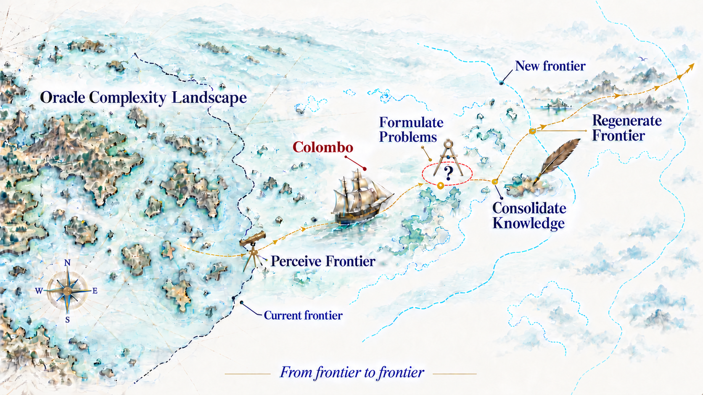
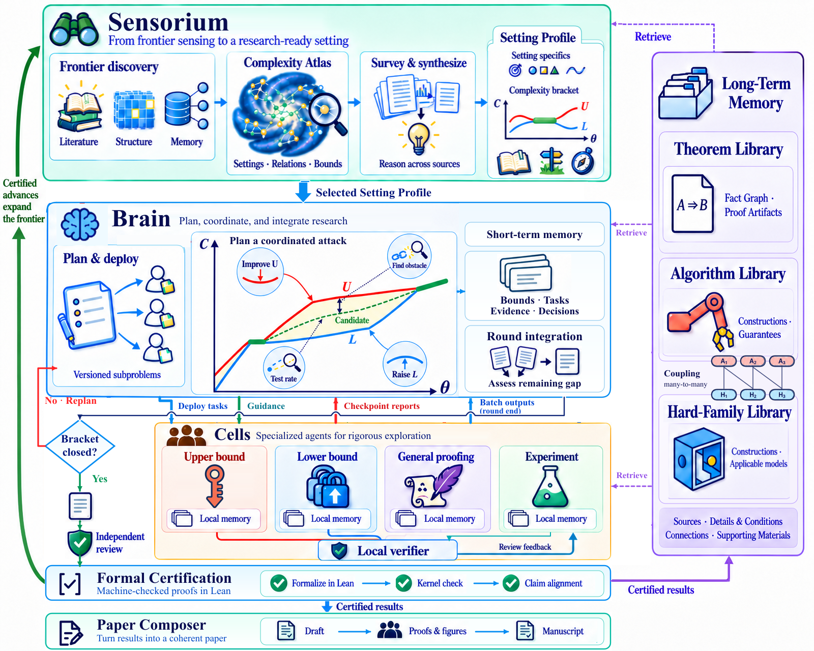
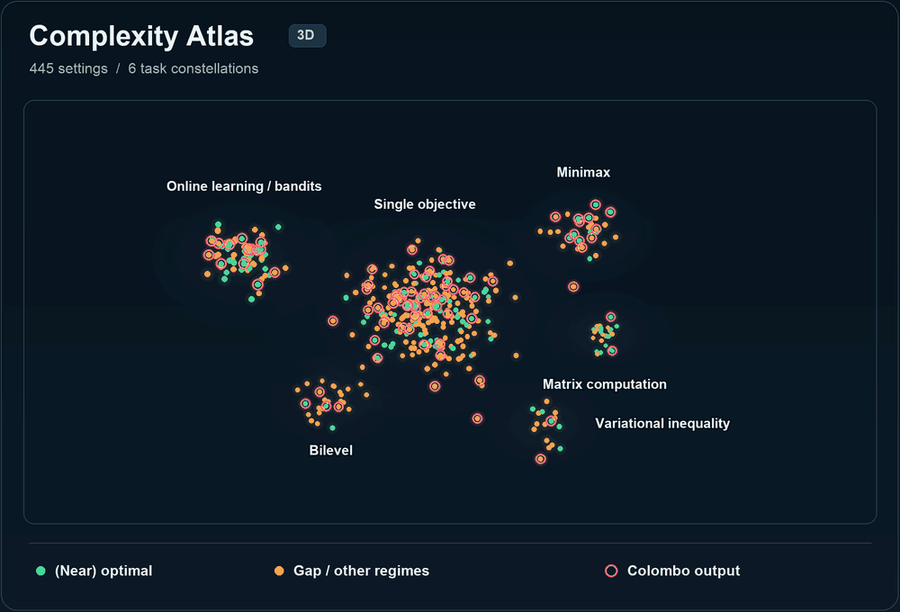

# Colombo: A Frontier-to-Frontier Autoresearch System for Oracle-Based Optimization

<p align="center">
  <a href="https://arxiv.org/abs/2611.23080"></a>
  <a href="LICENSE"></a>
</p>

**Formulate problems, investigate complexity gaps, verify findings, and preserve knowledge for further discovery.**

[Architecture](#how-colombo-works) · [Atlas](#explore-the-complexity-atlas) · [Components](#repository-components) · [Documentation](#documentation) · [Citation](#citation)

Colombo is a self-organizing AI research system for **oracle-based optimization**. It studies how efficiently a problem class can be solved through a prescribed information interface, and which costs every admissible algorithm must incur. Algorithms establish achievable **upper bounds**; hard-instance constructions establish unavoidable **lower bounds**. The gap between them defines a concrete research frontier.

Two mechanisms drive the system: **Self-Organization** adapts research programmes as evidence accumulates, while **Adversarial Co-Ascent** develops algorithms and hard families through reciprocal challenge. Independent review, Lean-based formal certification, and scientific memory support the transition from individual investigations to subsequent research programmes.

The [accompanying paper](https://arxiv.org/abs/2611.23080) reports optimal or near-optimal rates for more than fifty settings and describes 56 research works. This repository provides the system source, scientific memory, Sensorium tools, and Complexity Atlas data. Local research runs and model transcripts are excluded from the source distribution.



*Frontier-to-frontier renewal: supported discoveries reshape the research frontier and create the basis for further inquiry.*

## How Colombo works

### Frontier-to-frontier research

The **Complexity Atlas** records mathematically specified settings, their relationships, and the current state of knowledge. For a selected setting, the **Setting Profile** fixes the task, instance class, oracle, admissible algorithms, resource measure, success criterion, and known bounds. Its **Complexity Bracket** expresses the remaining question:

$$
L_s(\varepsilon,\delta;\theta)
\;\leq\;
N_s^*(\varepsilon,\delta;\theta)
\;\leq\;
U_s(\varepsilon,\delta;\theta).
$$

Here, $N_s^*$ is the optimal complexity under the declared model; $\varepsilon$, $\delta$, and $\theta$ specify accuracy, failure probability, and problem parameters. Improving an algorithm can lower $U_s$; a stronger hardness argument can raise $L_s$. Both sides must refer to the same assumptions and parameter regime.



*The paper's system architecture: frontier sensing supplies a Setting Profile; supported findings inform subsequent investigations.*

| Component | Role |
| --- | --- |
| **Sensorium** | Maps settings and complexity gaps; prepares Setting Profiles through literature discovery, structural exploration, and Atlas maintenance. |
| **Brain** | Plans research programmes, dispatches Tasks, integrates reviewed results, maintains the Live Complexity Bracket, and replans around the remaining gap. |
| **Research Cells** | Investigate upper bounds, lower bounds, general proofs, and experiments. |
| **Independent Verifiers** | Review Cell results and the exact final adopted proof, with decisions bound to the relevant claims and evidence. |
| **Formal Certification** | Uses Lean compilation, axiom checks, and claim-correspondence review to assess formalized results. |
| **Paper Composer** | Organizes accepted downstream material into a manuscript with proofs, references, and claim mappings. |
| **Scientific Memory** | Preserves sources, theorems, algorithm families, hard families, and reusable research knowledge. |

**Execution boundaries.** Brain/Cell research, Lean/Writing, Sensorium maintenance and Memory publication have separate entry points and evidence requirements. The [system guide](colobmo_system/README.md) describes the available workflows.

### Self-Organization


Self-Organization connects three levels of inquiry:

- **Field level:** the Sensorium identifies settings, maps bounds, and locates unresolved gaps.
- **Programme level:** the Brain forms candidate rates and technical routes, assigns subproblems, and revises its plan using reviewed evidence.
- **Problem level:** Cells investigate concrete claims, constructions, counterexamples, and experiments.

Partial progress and failed approaches can change the next assignment as well as a successful proof. Accepted discoveries can refine existing settings or motivate new ones, connecting progress within a programme to renewal of the research frontier.

### Adversarial Co-Ascent


Adversarial Co-Ascent makes **algorithm design** and **hardness construction** inform one another. Algorithms probe candidate hard families for exploitable structure; hard instances expose limitations in how candidate methods obtain and use information. These challenges guide stronger constructions, sharper conjectures, and new questions.

An experiment can reveal a useful pattern or failure mode. Establishing a complexity bound still requires a proof over the declared model class and parameter regime. Empirical evidence, independent natural-language review, and formal certification have distinct roles.

## Research highlights

The paper's [Research Outcomes](https://arxiv.org/html/2611.23080v1#S3) section describes the following programmes. Its statements and appendix specify the oracle models, assumptions, parameter regimes, and remaining gaps.

| Area | Selected focus |
| --- | --- |
| **Zeroth-order optimization** | Lower bounds and matching characterizations under specified value-oracle and query-domain assumptions. |
| **Randomized first-order optimization** | Accuracy exponents for smooth nonconvex optimization under fixed finite-order smoothness. |
| **Variational inequalities** | Higher-order algorithms and lower bounds, including stochastic weak-Minty sample-complexity limits. |
| **Stochastic bilevel optimization** | Accuracy limits and smoothness-dependent complexity under fresh, globally unbiased first-order samples. |
| **Nonconvex minimax optimization** | Complexity across stochastic, finite-sum, and full-Hessian information models. |
| **Geometry and matrix computation** | Hyperbolic optimization, simplex-based matrix games, and low-rank approximation. |

These are reported research outcomes, rather than a guarantee that a new run will reproduce them or solve an arbitrary submitted problem. The bundled Atlas provides setting-level records, sources, and exports.

## Explore the Complexity Atlas

Explore **445 problem settings** through an interactive 3D map, a 2D overview, and a searchable setting library.

### Current contribution coverage

The current release distinguishes the Atlas inventory, adopted contribution coverage, and source entries:

| Scope | Count | Meaning |
| --- | ---: | --- |
| Native problem settings | **445** | All settings in the Atlas, including unresolved and partially documented brackets. |
| Settings with an adopted Colombo contribution | **84** | The union of **49** settings attributed to public arXiv papers and **36** settings using retained local manuscripts, with **1** setting in both groups: **49 + 36 − 1 = 84**. |
| Pending attribution | **2 settings** | Retained for review and excluded from the adopted contribution count. |
| Registered public paper entries | **22** | Public arXiv sources in the contribution registry. |
| Retained local manuscript entries | **30** | Bundled unpublished research manuscripts in the local source catalog, including three Kimi manuscripts. |

**★ Colombo identifies an adopted contribution within its documented comparisons and parameter regions.** Mathematical status remains a separate label: an adopted contribution can improve a bound while leaving a gap. The **39-setting** historical near-optimal selection is retained as a separate subset of the contribution registry.

The **22 public papers and 30 local manuscript entries are source counts**; related versions and multiple settings require work-level deduplication before reporting a total number of distinct research works. The paper's **more than fifty settings / 56 research works** figures in the introduction retain their historical reporting scope. The current **84-setting** count records adopted contribution coverage, without asserting 84 new or near-optimal results.

The retained local manuscripts **N01, A4 and U10** have explicit contribution scopes in the source catalog, setting pages and profile downloads. N01 presents an alternative random-rotation construction and measurable transfer framework while acknowledging the known randomized main rate. A4 presents an alternative globally smooth macro-block construction and proof while acknowledging the existing matching weighted rate. U10 presents a uniform formulation and boundary geometry while acknowledging the prior Euclidean high-dimensional polynomial lower profile. These descriptions follow the current manuscripts and do not establish new priority dates or a new independent mathematical review.

[](colombo_sensorium/Complexity_altas/README.md)

The Atlas provides an interactive 3D map, a 2D overview and a searchable setting library. Each profile links its model, oracle, algorithm permissions, output, error metric, guarantee and resource budget to regional bounds and evidence. PDF, TeX and Markdown downloads preserve the complete profile.

## Repository components

| Path | Contents |
| --- | --- |
| [colobmo_system](colobmo_system/README.md) | Brain/Cell research, independent verification, Lean/Writing, and the bundled scientific Memory. |
| [colombo_sensorium](colombo_sensorium/README.md) | Complexity Atlas, literature-grounded discovery, structural exploration and Atlas renewal. |
| [assets](assets/) | Project illustrations and Atlas previews. |

The existing directory spellings `colobmo_system` and `Complexity_altas` are retained throughout the source tree. Current configuration files describe runnable defaults; they do not identify the configuration of every historical research run.

## Scientific Memory

The bundled scientific Memory contains **388 published records and 43 leads** across source, theorem, algorithm-family and hard-family libraries. The visible `long_term_memory/` library and its required `.long_term_memory_state/` preserve linked content objects, retrieval indexes and historical review commitments.

Brain and proof Cells have read-only scientific Memory access. The independent Memory Agent owns Curator/Reviewer and publication workflows. The public wording projection is recorded separately from the original scientific reviews. See [Memory](colobmo_system/docs/MEMORY.md) and [public projection provenance](colobmo_system/docs/MEMORY_PRIVACY_PUBLICATION.md).

## Lean and manuscript composition

Lean and Writing are independent downstream stages. The shared evidence validator checks source and project hashes, compiler and declaration/axiom audit output, complete Claim mappings, correspondence review and cached-artifact receipts against the same handoff.

Writing records whether evidence comes from a local Lean Agent or an imported report. Imported reports receive embedded structure and binding checks; Writing does not recompile them or authenticate their producer. Formalization covers the listed declarations and claims. The [downstream guide](colobmo_system/docs/DOWNSTREAM.md) describes these stages and their evidence boundaries.

## Documentation

- [System overview and usage](colobmo_system/README.md)
- [Source responsibilities](colobmo_system/SOURCE_LAYOUT.md)
- [Cell workflow](colobmo_system/agents/cell/README.md)
- [Experiment Cell](colobmo_system/agents/experiment_cell/README.md)
- [Independent Memory Agent](colobmo_system/colombo_memory_agent/README.md)
- [Sensorium overview](colombo_sensorium/README.md)
- [Complexity Atlas](colombo_sensorium/Complexity_altas/README.md)

## Citation

If Colombo informs your research, please cite the [paper](https://arxiv.org/abs/2611.23080):

```bibtex
@misc{zhang2026colombo,
  title         = {Colombo: A Frontier-to-Frontier Autoresearch System for Oracle-Based Optimization},
  author        = {Haihan Zhang and Wendao Wu and Chenheng Zhang and
                   Chunyuan Zheng and Yanyi Li and Cong Fang and
                   Haoxuan Li and Zhouchen Lin},
  year          = {2026},
  eprint        = {2611.23080},
  archivePrefix = {arXiv},
  primaryClass  = {cs.AI},
  url           = {https://arxiv.org/abs/2611.23080}
}
```

For authors of papers that use the Colombo system: Although optional, it is highly appreciated if you could send an email to [colombo.2026@outlook.com](mailto:colombo.2026@outlook.com) telling us your identity (name, position and affiliation) or the results obtained via Colombo (best with the link to the paper).

## License

Copyright 2026 Colombo contributors.

Colombo is licensed under the [Apache License, Version 2.0](LICENSE).

Third-party components and externally sourced materials retain their respective licenses and copyright/attribution notices. The bundled MathJax copies include their own licenses in the [visualization assets](colombo_sensorium/Complexity_altas/visualization/assets/mathjax/LICENSE) and [distribution assets](colombo_sensorium/Complexity_altas/visualization/dist/assets/mathjax/LICENSE).
