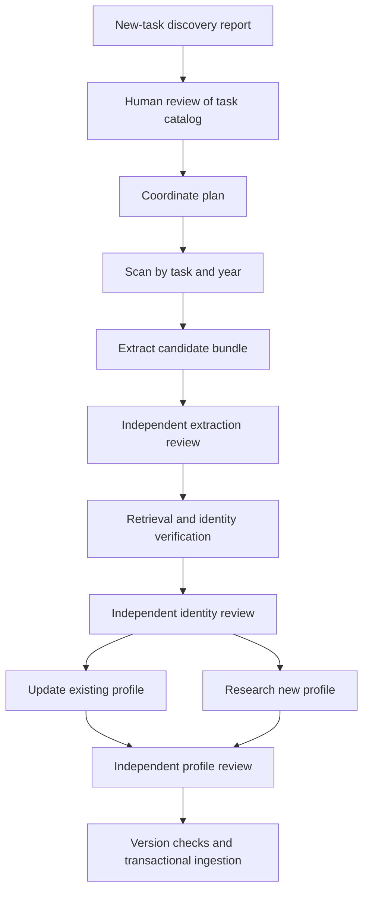

# Oracle Atlas Agents: Component Architecture

The component follows Colombo's layering of responsibilities, protocols, skills, and tool-driven sessions. Research objects, eight-axis specifications, labels, identity, and complexity standards come from existing Atlas practice. It does not copy Colombo's mathematical research content or its Brain→Cell→Subcell framework of multiple proof layers.

## 1. Three layers of responsibility

| Layer | Definition | Responsibility |
|---|---|---|
| Agent | `agents/<role>/AGENTS.md` | Who is responsible, how they work, what they may read/write, and when they finish |
| Protocol | Root and role-specific `protocol.md`, `schemas/` | Fixed records, interfaces, judgment scopes, versions, and recovery; schemas are the sole source of machine structure |
| Skill / standard | Role `skills/<name>/SKILL.md`, shared `skills/`, `standards/` | How to extract, match, retrieve, prove, synthesize, and review |

The runner explicitly loads the current role's AGENTS and short protocol, lists skill entry points, and lets the model call `resource_read` on demand. A role change must not merely rename a file without loading it. Each call records the instruction version, output schema, and tool permissions actually used.

Python manages persistence, tools, structural and reference checks, dependencies, budgets, state, and transactions. The LLM handles scientific interpretation, equivalence/identity, theorem applicability, short proofs, upper/lower synthesis, and independent review. Schema validity is not scientific correctness.

## 2. Ten runtime roles

| Role | Input | Formal output | Independent verification / effect |
|---|---|---|---|
| coordinator | User scope, approved tasks, queues, and budgets | plan | The controller executes ordinary dependencies; exceptions require explicit continuation |
| task_scout | Current task catalog and broad paper leads | task_proposal + English report | The task catalog expands only after human approval |
| paper_scanner | Approved plan | paper_batch with separate bibliography/source refs | Verified year events and sources must be retained |
| extractor | One paper and formal sources | Candidate bundle + extraction | extraction_reviewer |
| extraction_reviewer | Fixed extraction/candidates/sources | Scoped review | Continue by candidate assessment; sibling candidates do not stall together |
| matcher | Reviewed candidate and Atlas retrieval results | identity + recall_audit | identity_reviewer |
| identity_reviewer | Fixed identity and candidate/neighbor specifications | Scoped review | Branch after existing/new approval |
| bound_updater | Existing identity, previous profile/base_version, and paper | research: update or no_change | profile_reviewer(mode=update) |
| profile_researcher | Atlas-new identity, paper, and related leads | research: new + complete profile | profile_reviewer(mode=new) |
| profile_reviewer | Fixed proposal/final five-file bundle/sources, or no_change research | review + approved_bound_ids | The writer checks versions, commits, and produces a receipt |

The coordinator makes actual search-plan decisions within the approved scope. Models are not asked to repeat a synonymous decision for every deterministic dependency transition. Research agents choose their next literature, proof, or tool action within their tasks. An exception is not a new agent: continue under the affected responsibility with additional material or revision feedback.

## 3. Workflow

The diagram shows successful dependencies; unresolved work cannot flow automatically along a success edge. An individual bound issue isolates only dependent results. An unknown core native interface blocks identity. Format errors require protocol repair. New material and specification changes create new versions of the affected work.

## 4. Three unified boundaries

### Native-interface boundary

All primitive operations participate in scope checks. View overrides and object aliases are interpreted consistently. Human navigation may be broad, while machine facts retain the precise scope of the same operation/view/object. Bare Exact is not inferred for the entire interface from a mapped subset; unknown information is not silently discarded.

### Stage-handoff and recovery boundary

Roles return only a small handoff and fixed artifact refs. Raw responses, validated artifacts, rejection diagnostics, and scientific uncertainty are distinct. Recovery first reuses original receipts or completed responses. Protocol repair supplies the complete schema and diagnostics and cannot remove scientific rejection. Scientific revision requires new information or a specific change and reviews affected dependencies again. An invalid cache entry cannot masquerade as a pending valid result.

### Scientific-version boundary

Identity comparisons and profile commits bind to actual Atlas scientific versions. Rebuilding a browsing index does not create a spurious scientific conflict. Research can run in parallel; the final writer serializes commits and checks `base_version`. The complete five-file bundle is frozen first, then replaced transactionally under a single-writer lock with a journal and receipt. Component readers use the same lock. Old IDs, views, and aliases remain traceable.

## 5. Input size and memory

The content store retains immutable full texts, atomic results, proofs, and formal artifacts. Initial context contains only the goal, refs, short catalogs, budgets, and relevant issues. Tools read sources/specifications in pages; drafts are patched in sections. Unread papers remain queued, full-catalog identity retrieval remains in matching records, and profile research receives only related results and proof obligations.

Private memory for each agent/job records unfinished issues and references; it is not evidence. Formal knowledge consists of reviewed results, proofs, and profiles. A reviewer in a new session may read formal arguments and necessary originals but cannot read the producer's private memory. Independence does not mean reading only a summary or reinjecting every attachment in full.

Near a session limit, save a checkpoint and continue the next session by refs. Observe initial input, tool-page sizes, call budgets, and actual usage. Missing usage is unknown/null, not zero. Cumulative input tokens are not peak context.

## 6. Scientific priorities

Research follows the loop: read decisive sources → atomic results → short proofs/transfers → bracket synthesis → targeted gap checks. Compare upper and lower bounds using the six keys and valid domains. Existing windows may close through accuracy monotonicity, parameter reselection, or legal dimension padding. Honestly isolate unproved propositions rather than reducing the LLM to summarization or endless format filling.

Faithful extraction and theorem applicability are distinct; document-publication approval and bound adoption are distinct. A profile's active bracket may use only approved bounds. States such as All optimal rely on specific comparable windows. Missing bounds and quantified GAP may coexist; coverage is reported separately from mathematical status.

## 7. Delivery and acceptance

Engineering acceptance covers the actual path: verified bibliography → annual queue → candidates → independent review → identity → update/new/no_change → final review → receipt. It also checks partial issue resolution, recovery without replaying invalid caches, context limits, exact label scope, and version conflicts.

Offline/simulated tests establish interface and recovery behavior. Scientific acceptance with real papers and real models is reported separately; test counts cannot replace genuine receipts for new bounds/views/profiles. Complete component code and prompts do not guarantee that every literature investigation closes every GAP.
